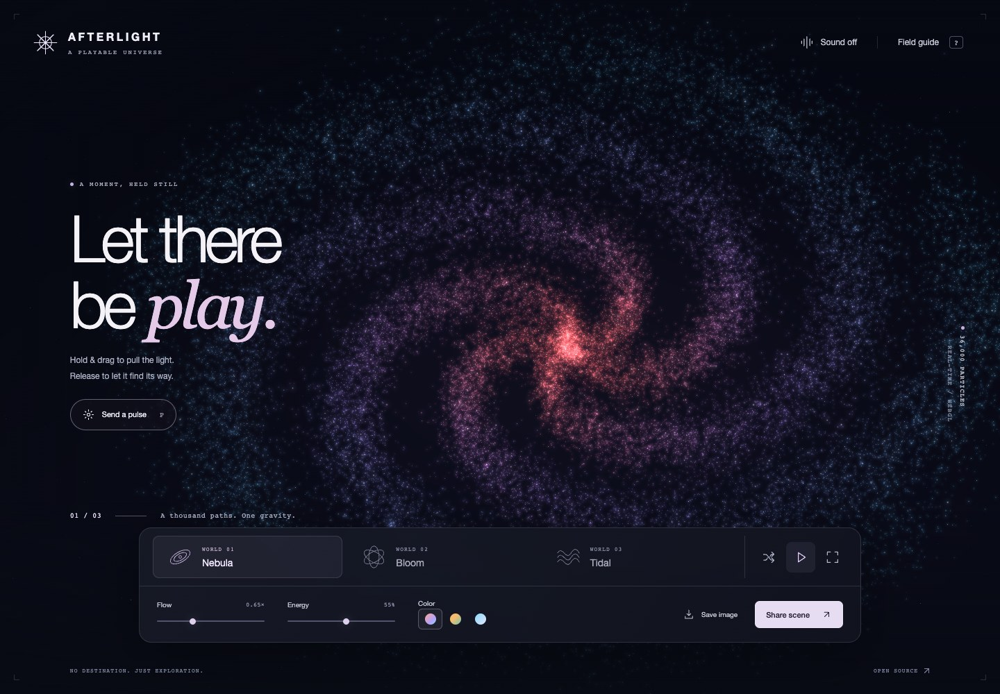

# Afterlight

A playable universe of light and sound. Pull a galaxy with your cursor, fold it into a flower, or turn it into a luminous tide.

**[Open Afterlight](https://baney75.github.io/afterlight/)**



## Play

Hold and drag the light. Release it to let the field settle. Choose **Nebula**, **Bloom**, or **Tidal**, then adjust the flow, energy, and color.

- **Send a pulse** makes an expanding wave.
- **Sound** enables an original ambient synth. Gestures play notes.
- **Save image** downloads a PNG of the artwork without the controls.
- **Share scene** copies a URL containing the world, palette, variation, flow, and energy. It restores those settings, not an exact animation frame or gesture history.
- **Hide controls** gives the artwork the whole screen.

Keyboard shortcuts work when the light field or page is focused. `1` / `2` / `3` change worlds, `P` sends a pulse, `R` makes a new variation, `S` toggles sound, `Space` pauses, and `H` hides the controls. Focus the light field and use arrow keys to pull it. `Escape` restores the controls or closes a dialog. Shortcuts do not override form controls or browser shortcuts.

Reduced motion starts paused. Press **Resume motion** to animate. Hidden tabs stop rendering and suspend sound. If WebGL cannot start, a simpler Canvas 2D artwork remains available.

## Run locally

Requires Node.js 22.12 or newer and npm.

```sh
git clone https://github.com/baney75/afterlight.git
cd afterlight
npm ci
npm run dev
```

Open the local URL printed by Vite. You should see a spiral of particles and three world controls. Hold and drag the field to bend it.

```sh
npm test
npx playwright install chromium
npm run test:browser
npm run build
```

The browser checks cover scene changes, pause and reduced motion, URL restoration, image export, unavailable WebGL, sound lifecycle, and controls at desktop, phone, and landscape sizes. `dist/` is a static site with relative asset URLs; it can be hosted in a subdirectory.

## How it works

The runtime has no third-party dependencies. Seeded particle positions feed custom WebGL shaders. The shaders morph between three forms, color by position, and respond to an attractor and expanding pulse. A separate Web Audio graph produces the pad and gesture notes. Vite and Playwright are development tools only.

- `src/engine.js`: rendering, fallback, animation lifecycle, and image export
- `src/audio.js`: opt-in synthesis and audio lifecycle
- `src/state.js`: bounded, versioned URL state
- `src/main.js`: controls, input, sharing, and accessibility behavior

No account, microphone, upload service, analytics, remote fonts, or external media is used. Scene settings live in the URL fragment. GitHub Pages still receives ordinary page requests when hosting the site.

This is a mathematical artwork, not an astrophysics simulation. Particle count and rendering speed depend on the device. Automated browser tests cannot establish compatibility with every GPU or physical audio output.

Built with the browser's [WebGL](https://developer.mozilla.org/en-US/docs/Web/API/WebGL_API/WebGL_best_practices) and [Web Audio](https://developer.mozilla.org/en-US/docs/Web/API/Web_Audio_API/Best_practices) APIs. All artwork and sound are generated by this project's code.

## License

[MIT](LICENSE).
